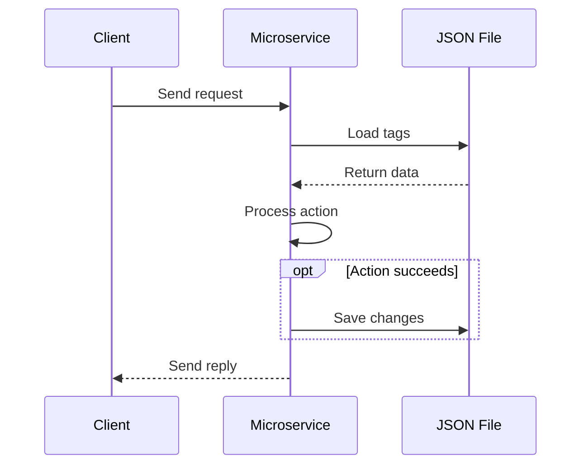

# CS361-Tagging-Categorization
Microservice for organizing information using tags and categories.

## Description
This microservice allows applications to create tags, assign tags to items, and remove tags from items.
It uses Python, ZeroMQ, and JSON messages on port 5557. Tags and assigned items are saved in `tags_data.json` so they can be used again later.

## How to Request Data
The client sends a JSON request to the microservice using ZeroMQ.

Example of creating a tag:

```python
import zmq

context = zmq.Context()
socket = context.socket(zmq.REQ)
socket.connect("tcp://localhost:5557")

request = {
    "action": "create_tag",
    "app": "notepad",
    "tag": "School"
}

socket.send_json(request)
```

There are three actions available:
- `create_tag` — Creates a tag.
- `assign_tag` — Assigns an existing tag to an item.
- `remove_tag` — Removes a tag from an item.

Example of assigning a tag:

```python
request = {
    "action": "assign_tag",
    "app": "notepad",
    "tag": "School",
    "item_id": 5
}

socket.send_json(request)
```

Example of removing a tag:

```python
request = {
    "action": "remove_tag",
    "app": "notepad",
    "tag": "School",
    "item_id": 5
}

socket.send_json(request)
```

The app identifies the application, tag is the tag name, and item_id identifies the item.
The client must receive a reply before sending another request on the same socket.

## How to Receive Data
After sending a request, the client receives the reply using:

```python
reply = socket.recv_json()
print(reply)
```

Example reply after creating a tag:

```json
{
    "status": "success",
    "message": "Tag School created"
}
```

Example reply after assigning a tag:

```json
{
    "status": "success",
    "message": "Tag School assigned to item 5",
    "item_id": 5,
    "tags": ["School"]
}
```

Example reply after removing a tag:

```json
{
    "status": "success",
    "message": "Tag School removed from item 5",
    "item_id": 5,
    "tags": []
}
```

If the tag already exists, the microservice returns an error:

```json
{
    "status": "error",
    "message": "Tag School already exists"
}
```

## UML Sequence Diagram



## How to Run
Install the required library:

```bash
pip install pyzmq
```
Start the microservice:
```bash
python tagging_service.py
```
Then run the client program separately to send requests.
The microservice will keep listening for requests on port 5557 until it is stopped.
